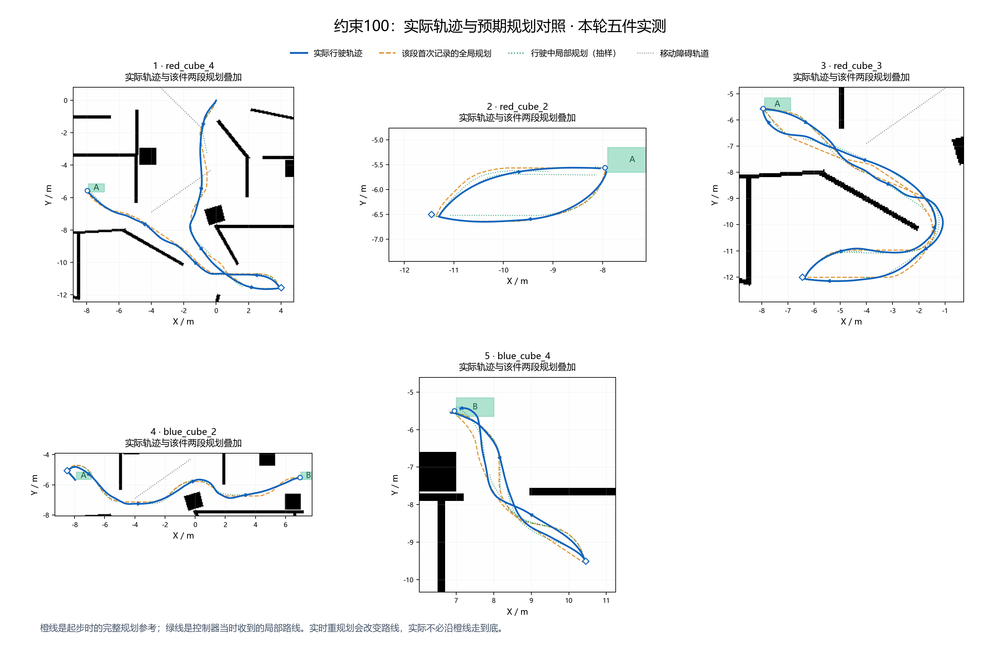
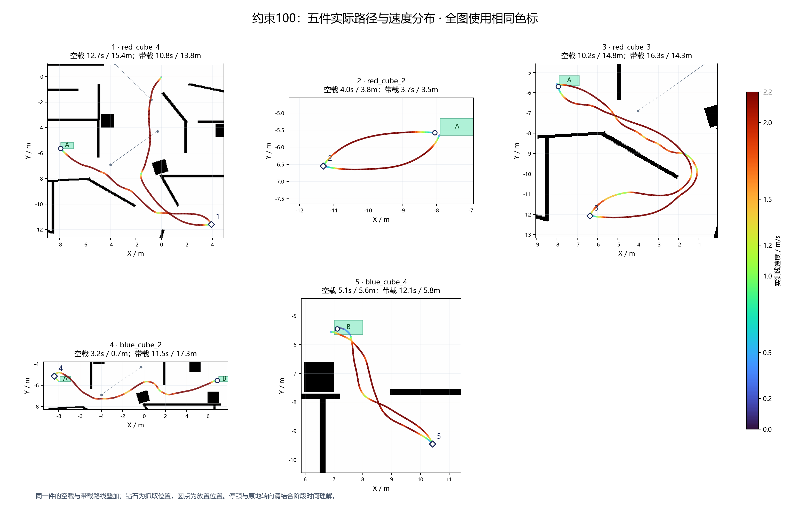
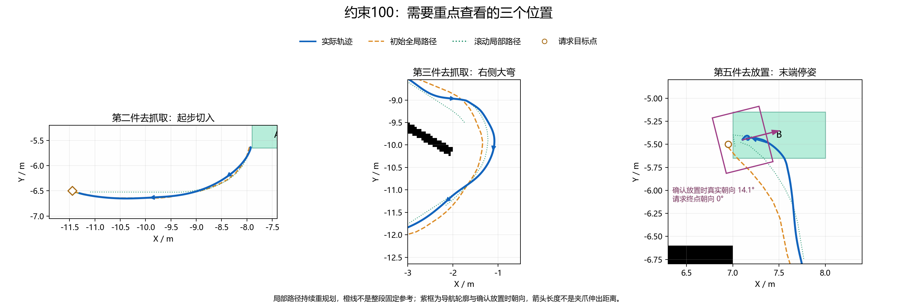

# 小地图测试、运动诊断与轨迹绘图手册（2026-10-15）

本文面向继续开发、执行实验和复核结果的人，记录本项目已经采用的方法、可复核结论、数据限制，以及后续建议。内容以本地源码、实际参数记录、原始试验数据和绘图脚本为依据。运行代码基线为 `49928732f535bc76be90c5985dc9b5c7964cdcab`；首版交接文档提交为 `5205588553043ab9fff83a1be16e65c64868bb55`。本次扩写没有重新运行仿真，文中所有实测数值均属于明确标注的历史轮次；建议协议不表示已经实现或通过。


2026-10-15后续试验更新：本机世界与生成器ODE参数已改为200，正式导航目标仍2.2。2.5/3.0/3.5 m/s各四项短测已完成；直行均达标，3.0/3.5高速圆弧出现轮速到位但车身响应异常，详见[速度与左右轮复核](linear-speed-limits-20261015.md)。本文100档五件记录继续作为历史基线，不能当作200档整轮验证。

## 阅读导航与结论等级

- 第 1—4 节：环境、分层试验、现有短测协议。
- 第 5—7 节：数据采样、完整五件流程、绘图方法。
- 第 8—9 节：证据位置、交付要求。
- 第 10—12 节：运动链路、制动计算、计时与逐阶段结果。
- 第 13—15 节：数据字段、几何与坐标变换、严格指标定义。
- 第 16—18 节：可复用操作、故障诊断、后续验证与迁移。

文中“实测”表示已有对应原始记录；“源码行为”表示当前代码或配置能够直接确认；“推断”需要同时满足所列前提；“建议”尚未作为本轮测试实施。目录名和历史报告中的“当前”仅描述该报告写作时的状态，以本文参数基线及运行时读数为准。

## 1. 接手时先确认环境

真正的开发、构建、仿真副本是 **WSL `/home/polarbear/ws_aic`**。Windows 的 `C:/Users/21920/.codex/worktrees/4d7b/AIC` 是另一个副本，不能直接覆盖过去。Windows Git 通过 `//wsl.localhost/Ubuntu-22.04/home/polarbear/ws_aic` 管理实际副本；ROS、Gazebo、colcon、llama 在 WSL bash 执行。

先检查实际副本的 Git status/diff、HEAD、场景和运行进程。当前本地分支名可能仍是 `codex/no-wall-slowdown`，判断版本看提交，不要把分支名当作代码过期的证据。不要为了整理环境执行整目录 restore、checkout 或 clean。

```bash
# 以下均在 WSL bash 中执行
cd /home/polarbear/ws_aic
bash ros_competition_start.sh status
# 有本项目旧栈时，先正常停止
bash ros_competition_start.sh stop
# 源码有变化且需要构建时
bash ros_competition_start.sh build
```

根入口构建使用 `colcon build --symlink-install --base-paths src`。修改源码后确认构建和实际加载的库一致，不能“测试旧 install 库，交付新源码”。测试前保存源码、配置和库的 SHA-256，运行后读取实际参数再核对。

### 当前参数基线

| 项目 | 本机当前配置；历史成绩另列 |
|---|---|
| 默认场景 | `scenarios/short_routes_20261007`，新的办公室地图 |
| 线速度 / 线加速 / 线减速 | 2.2 m/s / 3.5 m/s² / 5 m/s² |
| 角速度 / 角加减速度 | 4 rad/s / 10 rad/s² |
| 驱动轮转矩上限 / 单轮加速度限幅 | 1000 Nm / 关闭 |
| 驱动轮与地面摩擦 | 两个方向均为 1；支撑球保持 0.01 |
| 车体 / 驱动轮 | 底盘 10 kg，两个驱动轮各 1 kg，轮半径 0.065 m、轮距 0.53 m |
| 货物 | 0.1 kg、边长 3 cm、主惯量 0.000015 kg·m² |
| ODE | `contact_max_correcting_vel=200`，迭代 60、步长 0.001 s |
| 控制 / 平滑器 | 20 Hz / 30 Hz，平滑器 OPEN_LOOP、`scale_velocities=false` |
| 导航 | TimeAwarePlanner + TimeAwareController，SimpleGoalChecker |
| 减速与保护 | 墙边距离减速、RPP 代价减速关闭；曲率、终点和预测碰撞保护保留 |

用户要求：不添加固定等待点，不把移动障碍整条轨道永久涂黑。允许查询仿真障碍真实状态，采用滚动预测。`mu1/mu2` 是两个摩擦方向，不能简单写成“静摩擦/动摩擦”。

## 2. 三层测试分别回答什么

| 层级 | 做法 | 能回答的问题 | 不能据此证明 |
|---|---|---|---|
| A：空场物理响应 | 简单平地直接发速度，固定坡道，测轮子与车身 | 转矩、接触约束、加速制动、圆弧响应 | Nav2 跟踪和完整搬运成功率 |
| B：简单路线跟踪 | 同一空场给定直线/弯道，实际走规划器和控制器 | 前视、曲率、转向切换、末端跟踪 | 复杂动态场景稳定性 |
| C：新地图五件 | 当前办公室地图，三红 A、两蓝 B，记录十段导航 | 综合路径、动态避障、抓放、总耗时 | 单轮不能代表长期成功率 |

过去扭矩与 ODE 对照主要属于 A。空场配置里虽然启动了普通 Navfn/RPP，直接速度测试并没有实际执行路径跟踪，不能称为 B 的回归。先用 A 缩小物理原因，再做 B，最后做 C，避免每调一个参数都耗时跑五件。

## 3. 隔离空场与参数

已经用过的空场资源位于：

`/home/polarbear/.local/share/aic-runs/20261014-torque1000-friction100/simple-field/`

其中 `mu1.world` 是固定摩擦 1 的空场，配套 `map.yaml`、`map.pgm`、`tasks.yaml`、`nav2.yaml`。不要因目录名含 friction100，就误以为所有子文件仍是摩擦 100；应解析具体文件并读取运行模型。更早资源来自 `20261012-turn-only/simple-field/`。

为新试验建立新的外部运行目录，把这组资源复制过去再修改，不覆盖历史记录。world、map、tasks、nav2 四个路径一起显式指定：

```bash
cd /home/polarbear/ws_aic
# 替换为本轮已准备好的绝对路径
export AIC_WORLD=/absolute/path/to/trial/field.world
export AIC_MAP=/absolute/path/to/trial/map.yaml
export AIC_TASK_CONFIG=/absolute/path/to/trial/tasks.yaml
export AIC_NAV_PARAMS=/absolute/path/to/trial/nav2.yaml
bash ros_competition_start.sh start --headless
```

`start` 只启动、等待发令；`benchmark` 才自动发五件。空场物理测试用 `start`，不要误触完整搬运。必须 `--headless`，检查没有 `gzclient`；Foxglove 数据仍可用。空场边界和安全余量必须适合测试动作，不能在办公室墙边直接复用空场速度探针。

每档冷启动，核对 `/robot_state_publisher` 的实际 `robot_description`、驱动插件转矩、两轮摩擦、地面摩擦和实际物理参数。单看源文件不足以证明加载成功。历史扭矩脚本临时改过机器人 xacro，并在 finally 恢复；后续优先采用隔离资源。若仍需临时修改，逐文件备份、退出恢复、最后审阅 diff，不用全仓库还原。

回到新地图前清掉上面四个测试环境变量，或在干净 shell 中启动，防止继续加载空场。不要把空场的普通 Navfn/RPP 配置覆盖回新地图。

## 4. 两套有效的短测协议

### 4.1 固定摩擦 1，只扫描转矩

实际测试档位为 **1、20、200、500、1000 Nm**，其余保持。当时 ODE 约束为 **34**，不是当前发布的 100。每档同样五项：

| 动作 | 目标 v / ω | 保持时间（仿真秒） |
|---|---|---:|
| 正向原地转向 | 0 / +4 | 1.3 |
| 反向原地转向 | 0 / −4 | 1.3 |
| 直行 | 2.2 / 0 | 1.6 |
| 低速圆弧 | 0.5 / (0.5÷1.1) | π÷(0.5÷1.1) |
| 高速圆弧 | 2.2 / 2 | π÷2 |

从 `/cmd_vel_nav` 发令，让现有 velocity_smoother 生效，同时记录其输出 `/cmd_vel`。每项前停车约 0.8 秒，复位到空场中心、朝向 0、速度归零，再稳定约 0.7 秒；动作后给停车指令并记录约 1.2 秒。正式统计前剔除复位跳变。

25 项有效记录按当时脚本核验通过：首个非零底盘指令延迟不超过 0.25 秒，达到目标不迟于理论爬升时间加 0.25 秒。旧 Twist 记录使用约 0.1 秒量化的接收时钟，部分首个非零时间会略为负值；它不代表物理系统提前响应，也不能视为精确通信延迟。1000 Nm 首次记录曾有约 0.5/1 秒输入迟到，原始记录保留，但以冷启动复测替换，不能把它当成低扭矩/高扭矩响应差异。

结论仅限当时条件：1 Nm 加速/制动与高速圆弧明显差，20 Nm 以上收益很小。旧限制未解除前，不能据此认为继续加转矩就能解决约 1 rad/s 平台。现在若在 ODE=100 重做，要单列新结果。

### 4.2 只扫描 ODE 接触约束

实际档位 **20、34、60**；转矩固定 1000 Nm、摩擦固定 1。每档直行 2.2、直行 3.5、高速圆弧 2.2+2，各重复两次，共 18 项。三份世界除约束值、诊断输出路径外保持相同，并做归一化 XML 哈希校验。

为隔离物理层，先停用 velocity_smoother 并确认 lifecycle 为 inactive；直接向 `/cmd_vel` 发相同限加减速坡道，线加/减速 3.5/5、角加减速 10。不能与仍在输出的平滑器争抢 `/cmd_vel`。3.5 m/s 只是诊断目标，不改变默认导航上限 2.2。

测试保持时间分别为 1.8、1.7、2.3 秒，统计窗口从动作开始后 1.1 秒到停车前 0.1 秒。若新试验在窗口里仍未稳定，要明确标为动态响应，不能假定稳态。

| ODE 值 | 3.5 指令实速 m/s | 高速圆弧车身 ω rad/s | 外轮原生 ω rad/s |
|---:|---:|---:|---:|
| 20 | 1.300 | 约 0 | 20.000 |
| 34 | 2.210 | 1.027 | 34.005 |
| 60 | 3.500 | 2.101 | 42.007 |

这证明该值在本 Gazebo 11.10.2/ODE 模型里影响实际关节限速；它原本是接触穿透修正速度参数，不能普遍解释成“车辆最大速度”。60 档只请求到 3.5，未测得其最高速度。当前 100 是随后完整流程采用的值，不属于这 18 项三档对照。

短测探针在倾角超过 5°、车身中心 |x| 或 |y| 超过 7 m、z 超过 0.3 m，或仿真时钟长时间不推进时中止；finally 发零速并由外层停栈。5° 是中止阈值，不能写成可接受倾角。新地图不能照搬空场边界阈值。

## 5. 采样和判定：最重要的经验

同时记录输入、执行输出、物理响应，才能定位限制在哪层：

| 数据 | 用途与注意事项 |
|---|---|
| `/cmd_vel_nav`、`/cmd_vel` | 区分导航目标与平滑后真正送到底盘的命令；Twist 无源时间戳，记录接收单调时钟及当时仿真时钟 |
| `/odom` | 保留源仿真时间戳、位姿、v/ω；校验采样间隔，不能把接收墙钟当仿真时间 |
| Gazebo 原生车体状态 | WorldUpdateEnd 约 100 Hz，世界位姿、线速度、角速度和倾角；核验 ROS 记录 |
| 原生关节状态 | `Joint::GetVelocity(0)` 与 Position 同时保存，不能只根据 TF 差分推断真实转速 |
| 任务与导航事件 | `/task_stage`、`/manual_nav_target`，用于分件、区分抓取/放置和确定目标 |
| 计划与预测诊断 | `/plan`、`/received_global_plan`、`/known_timed_plan`、`/known_predictive_control` |
| 障碍物 | `/design_obstacle_left/motion_state`、`/design_obstacle_right/motion_state` |

**TF 陷阱已有实证：** ODE=34 高速圆弧时，外轮 TF/Position 差分约 42 rad/s，原生 GetVelocity 只有约 34。先前“轮子达到目标而车身没跟上，因此是打滑”的解释已经撤回。车身轨迹和限幅对照仍有效，不要继续引用旧轮速图证明打滑。

原生插件找车体 link 时先试 `base_link`，找不到再试 `base_footprint`，固定关节合并可能改名；曾因没有 fallback 导致文件为空。采样开始必须确认参数首行和 motion 行都已产生。读取 `dWorldGetContactMaxCorrectingVel` 验证内核实际值。非有限值写 JSON null，不能当 0。

交叉核验可用：展开 yaw 后对仿真时间拟合角速度，与原生 angular.z 比较；线速度同时看车体前向投影和世界水平模长。差速理想关系为 `v=r(ωR+ωL)/2`、`ω=r(ωR−ωL)/b`，r=0.065、b=0.53；它用于诊断，不是实际无滑移的保证。

减速指标应同时给“收到停车命令后多久停下”和“额外走了多远/转了多少”。软件爬坡、消息迟到、接触限制都可能影响结果。旧 Twist 记录的仿真时钟约 0.1 秒量化，小于几十毫秒的档位差不作结论。没有真实稳定平台就不报告稳态速度。旧探针的停止时刻是首次满足 `|ω|<0.2 rad/s 且 |v|<0.1 m/s` 的采样；若未满足，脚本退回记录末点，原指标没有单独的“未停止”标记。新协议应补充是否确实达到停止判据和持续时间，避免把记录结束当成已停车。

## 6. 小测通过后怎样跑完整流程

恢复默认场景、配置和需要的控制节点状态后，在无旧 Gazebo 的环境里执行：

```bash
cd /home/polarbear/ws_aic
unset AIC_WORLD AIC_MAP AIC_TASK_CONFIG AIC_NAV_PARAMS AIC_SCENE AIC_BENCHMARK_TASKS
bash ros_competition_start.sh benchmark --headless
```

默认三红 A、两蓝 B，顺序保持输入约定。基准工具等待 `/competition/ready` 空闲就绪及 `/chat` 主控订阅匹配，只发布一次已解析任务，并等待接收确认。未确认属于基础设施/发令失败，不能算搬运运动失败，也不能在同一栈里盲目重发导致任务重复。

要画规划对照，计划观察器必须在任务发出前开始记录；仅运行默认 benchmark 得到 motion/phases/result，还不足以补画历史规划。要用原生物理轨迹，还需在本轮 world 启动前装入诊断 WorldPlugin。实际参考编排为外部 `20261014-limit100-flow/run_flow.py`，不要未经检查直接重放旧脚本。

`/task_stage` 仅在状态变化时发布，不能用它当周期存活信号；`/competition/ready` 周期发布。完整成功要核对五次抓取、五次放置、最终货物区域/高度、是否重导航和是否触发失稳/碰撞中止，不能只看最后 WAIT_TASK。

当前 100 档单轮成功：任务事件计时 **160.78 墙钟秒 / 134.5 仿真秒**；原始轮询计时 **162.25 / 136.4**。后者含起始 `/clock` 积压与末尾轮询/查询开销，不能混用。新基准输出 `task_event_wall_seconds`、`task_event_sim_seconds`；同时保留原始字段。计时不含冷启动与自然语言解析。

## 7. 绘图流程与解释边界

### 7.1 先整理数据，再出图

1. 保留原始 JSON/JSONL；用任务事件的源仿真时间划分五件、十段导航，不按空间邻近猜测所属件号。
2. 记录每段目标、开始/结束状态、带载状态。抓放和阶段衔接另用灰线，不混进导航指标。
3. 原生 motion 先检查 sim 的单调性、重复和倒退；新启动或时钟重置分成独立会话，不能简单排序后把不同会话合并。会话内可审计后去重，复位跳变、丢包和跨阶段不能直接连线。
4. 地图从本轮 `result.scene.map` 读取 resolution、origin、图像及对应 layout；不要凭截图估坐标，或误用旧地图。当前绘图实现假定地图 origin yaw=0；其他地图需补旋转变换。
5. 参考脚本用 `imshow` 的 world extent 与图像朝向对应地图；检查几个墙角/目标坐标对齐。坐标轴等比例，单位米，关键转弯用局部放大。

### 7.2 预期路径与实际路径

同时画三层：蓝色实际世界轨迹、橙色首次全局计划、绿色滚动局部计划抽样。后两者含义不同；系统持续重规划，实际轨迹不必始终贴住首次计划。

全局 `/plan` 标为 map frame，实际轨迹来自 Gazebo world，二者不能无条件视为同一坐标。本系统的 FrameAlignment 修正用于规划/控制的碰撞验证，输出的路径仍是 map 坐标；历史绘图脚本将橙色 map 路径直接叠到世界底图，未另外应用完整的逐时刻 map→world 变换。因此橙线可帮助观察路线形状，但不能把它与蓝线的间距直接称为严格物理跟踪误差。做精确评估时，必须保存同时刻定位/TF与真实位姿，并显式转换全局路径。局部 `/received_global_plan` 若为 base_link frame，参考脚本使用**该消息 stamp 对应的真实底盘位姿**转换到世界：

```text
world_x = body_x + cos(yaw) * local_x − sin(yaw) * local_y
world_y = body_y + sin(yaw) * local_x + cos(yaw) * local_y
```

yaw 先 unwrap 再插值。参考脚本遇到相邻原生位姿间隔超过 0.20 秒或时间超出记录范围就不插值，不能用“当前位姿”变换几百毫秒前的路径。按本段请求时刻、目标端点和阶段筛选计划，剔除上段残留及候选预览；不要把所有 `/plan` 都当作已执行路径。局部计划约每 0.2 墙钟秒抽样，图例说明抽样而非完整计划流。

100 档原生记录的 `wall` 是从 ROS 接收时间插值得到，只供绘图辅助；真实分段使用 sim，不能拿插值 wall 宣称精确墙钟耗时。保留 `native-motion.jsonl` 和 `plotting-provenance.json`，不要用加工数据覆盖原始数据。

运动样本到最近局部折线的几何距离可作辅助诊断，但重规划常从当前车身附近起步，会使距离偏小。100 档报告的中位/P95并非固定参考的严格横向误差。要验证控制器跟踪能力，另做固定路线试验，限制参考路径变化并记录路径版本与沿程进度。

### 7.3 用颜色表达速度

用 Matplotlib `LineCollection` 按相邻点组成线段，颜色取两端实测水平速度均值。五张分图统一 `Normalize(0, 2.2)` 和同一色条；超过 2.2 的瞬态峰值显示最高色，但报告真实峰值。不要每张图自动归一化。

当前原生速度采用 `hypot(vx,vy)`；短测前向速度是另一种量，轴标题需区分。相邻时间间隔不在 (0,0.20) 秒、件号或阶段不同时不连线。不要平滑掉真实弯钩/蛇行，也不要把位姿跳变画成高速直线。历史速度着色脚本有 0.20 秒断线规则；旧 `plot_routes.py` 的路径长度统计使用小于 1 秒的间隔，普通 plot 还可能连接筛选后的不连续片段。后续重用应统一有效性掩码，旧图不能当成严格的全时段连续性验证。

### 7.4 短测曲线和预期积分轨迹

每项相对动作开始时间对齐，叠加输入指令、平滑器输出和实际 v/ω；阴影标出统计平台，竖线标出停车请求。参数对照尽量使用统一坐标轴，重复试验单列或说明合并方法。

预期运动曲线从实际送到底盘的命令按零阶保持分段积分，而非直接积分名义阶跃目标。对常值 v、ω，圆弧精确积分；ω 接近 0 时用直线形式。它代表理想运动学参考，含指令时间戳误差，不等于规划器路线，也不能单靠偏离它判定轮胎打滑。

### 7.5 出图后人工验图

导出 PNG 后实际打开，检查中文字体、图例、色条、方向箭头、裁切与标注遮挡。参考脚本使用 Agg 后端、`/mnt/c/Windows/Fonts/msyh.ttc`；换机器需选可用中文字体。优先给全局图、五件/十段分图、问题局部三种视角，图片直接标明试验条件与数据来源。

当前复核：第二件没有原来的反复蛇行，但切入仍有弧线；第三件右侧大弯外扩；第五件末端弯钩且真实停车朝向约 14.1°，请求为 0°。五件放置合格不代表路径完美或停车朝向准确。不同轮次障碍相位、接近方向和参数不同，不能从两张图直接给严格改善百分比。

## 8. 脚本、证据与复用注意事项

以下短名均相对于 **`/home/polarbear/.local/share/aic-runs/`**，是本机外部证据目录，Git 克隆不会自动带走。移交到其他机器需要另行复制；不要把大型日志、生成库或模型权重提交进仓库。

| 目录 | 接手优先看 | 说明 |
|---|---|---|
| `20261014-torque-sweep-mu1` | `REPORT.md`、`comparison.png`、`input-validation.json`、`torque_sweep.py`、`response_probe.py` | 五档扭矩 25 项有效短测，包含 1000 档替换复测；旧 TF 轮速推断已更正 |
| `20261014-torque1000-friction100/simple-field` | `mu1.world`、`map.yaml`、`map.pgm`、`tasks.yaml`、`nav2.yaml` | 空场资源；同级还保存被排除的旧实验，不混用 |
| `20261014-contact-limit-test` | `REPORT.md`、`comparison.png`、`input-validation.json`、`metrics.json` | ODE 三档 18 项；原生数据在 `limit-*/native.jsonl` |
| 同上 | `contact_probe.cpp`、`prepare.py`、`run_limits.py`、`probe.py` | 原生 API、编译、隔离世界与短测编排参考 |
| `20261014-limit100-flow` | `REPORT.md`、`provenance.json`、`plotting-provenance.json`、`round-1/result.json` | 100 档五件、计时与版本证据 |
| 同上 | `run_flow.py`、`observe_plans.py`、`route_native_probe.cpp` | 完整流程编排、规划观察与原生采样 |
| 同上 | `prepare_plots.py`、`plot_routes.py`、`plot_speed_routes.py`、`plot_planned_vs_actual.py`、`focus_and_summary.py` | 图表数据加工与绘图；准备脚本部分依赖历史 07 目录 |
| `20261015-main-publish` | `build.log`、`python-tests-final.log`、`cpp-result.log`、`default-start-proof.json` | 14 包构建、49 Python、13 C++、默认启动验证 |
| 同上 `/unvalidated-world-goal-draft` | `README.md` 与原文件 | 未验证终点修正草案，未包含在当前发布源码，不能误用 |

**旧脚本是试验记录，不是开箱即用的通用测试工具。** 多数写死输出路径和旧参数；`prepare.py`、扫描脚本可能改源码/启动仿真，部分 `analyze.py`、绘图脚本还会重写仓库文档或旧报告。复用前读全部副作用，复制到新运行目录，改输出和配置路径，固定输入快照，禁止直接覆盖已有结果。

绘图依赖还包括 `20261014-clearance-routing-07` 的历史脚本/快照，以及场景 map/layout。准备交给另一台机器时，一并带上必要资源或把路径参数化。重画已整理好的 100 档图时顺序是 `plot_routes.py` → `plot_speed_routes.py` / `plot_planned_vs_actual.py` → `focus_and_summary.py`；先在副本中验证输出，保留原图。

仓库内可长期阅读的记录：

- [ODE 三档对照](contact-limit-20261014.md)
- [固定摩擦扭矩对照](torque-sweep-20261014.md)
- [100 档完整流程与已审阅图片](limit100-flow-20261014.md)
- [墙角坐标与制动检修](corner-frame-and-braking-20261014.md)
- [货物惯量与第二件蛇行修复](cargo-inertia-and-turning-20261012.md)

## 9. 下一位执行者的最小交付

每轮至少保留：版本与实际参数、输入有效性结论、原始带时间戳数据、分项指标、失败/中止原因、全局和局部路径图、统一色标速度图，以及实际/预期路径对照。注明是否空载、是否经过平滑器/导航、统计窗口和计时口径。

推荐从当前 ODE=100 基线做固定路线跟踪与末端制动短测；已有物理限幅证据不能再拿来解释所有剩余跟踪偏差。先通过图片定位问题段，再同步检查目标/输出/实际角速度、路径切换、坐标系和末端判定。参数或算法有改变后，仍需恢复新地图跑完整五件并核对最终落点。

## 10. 从目标到真实运动：限制可能出现在哪里

### 10.1 当前执行链

```text
已解析的两组搬运任务 /chat
  → 主控选块及候选去程/回程规划 SELECT_BLOCK
  → NavigateToPose / 持续导航行为树
  → TimeAwarePlanner：生成并更新 map 路径
  → TimeAwareController：RPP 名义指令 + 真实状态预测检验与候选选择
  → /cmd_vel_nav
  → velocity_smoother：频率、速度与加减速约束
  → /cmd_vel
  → Gazebo 差速驱动插件：目标轮速、转矩上限等
  → ODE：质量惯量、轮地接触、摩擦与约束求解
  → 实际车体/关节状态
```

“角速度没有达到目标”至少有三个不同问题：上游根本没请求该速度、执行命令被软件修改、执行命令正确但物理响应不足。只看一条实际角速度曲线无法区分。建议每张诊断曲线至少同时显示 nav_w、cmd_w、actual_w；圆弧还要显示 v 和两个实际关节转速。

### 10.2 当前源码中仍存在的减速、限幅和动作变化

| 位置 | 当前行为 | 如何验证 |
|---|---|---|
| 规划器墙边距离分支 | YAML 关闭；不再因静态中心净距小于 1.10 m 就把名义速度压到 1.2 | `GridBased.slow_near_static_obstacles=false` |
| RPP 代价减速 | YAML 关闭 | `FollowPath.use_cost_regulated_linear_velocity_scaling=false` |
| 规划器静态/动态软代价 | 影响路线选择，静态首选净距 0.85、权重 3，动态权重 4 | 规划日志、生成路径、配置 |
| RPP 曲率减速 | 保留，半径较小时允许降低线速度 | `use_regulated_linear_velocity_scaling=true`，半径 1.1、最低值 0.18 |
| RPP 末端接近减速 | 保留，接近范围 1.2、最低接近速度 0.08 | 末端 v 与剩余距离 |
| RPP 转向对齐 | 保留；朝向差大时可能先原地转，线速度为 0 | 阈值 0.65 rad、请求 4 rad/s，结合角加速度限制 |
| 预测控制器 | 可改选较慢、改变转向、原地对齐、受检验的短距离后退 | `/known_predictive_control` 的 nominal/selected、escape/retreat |
| 平滑器 | 最大速度 [2.2,0,4]，最小 [-0.3,0,-4]，线加减 3.5/5、角加减 10 | `/cmd_vel_nav` 与 `/cmd_vel` 对照 |
| 目标/进度判定 | 达标或超时会结束/重试导航 | SimpleGoalChecker、SimpleProgressChecker、动作结果 |
| 物理层 | 当前转矩 1000、接触约束 100，仍有动态响应和接触求解误差 | 原生关节与车体 API |

关闭“墙边距离减速”不等于“任何情况下都不减速”。弯道、末端、角度对齐和碰撞预测仍会使速度下降。软代价改变路径，也可能间接改变路程与耗时，不能只按某个字段名称认定它直接限制车速。

普通 RPP 的 `use_collision_detection=false` 只在当前自定义 TimeAwareController 提供独立预测/轮廓检查的上下文中使用，不能直接复制到没有该保护的普通控制器。行为树没有固定等待、spin 或 backup 节点；YAML 中存在行为插件、waypoint 等配置条目，不代表本轮主导航实际执行了这些节点。控制器内部有受保护的短后退候选，即使 RPP `allow_reversing=false`，也不能宣称本系统绝不倒车。

### 10.3 实时规划与预测实际能保证什么

行为树 RateController 的目标重规划频率是 5 Hz；搜索耗时、调度和失败会让实际成功发布频率更低，不能把它写成每 0.2 秒必有有效新路径。规划器 `expected_planner_frequency=10` 也不是已达到的吞吐量。规划搜索时间参数为 1.5 秒，源码按一定迭代间隔检查预算，不能当硬实时上界。

新计划成功才替换旧路径，搜索失败不会立即抹掉仍可用的计划。控制器每次计算使用实际状态继续检验。当前搜索有 0.20 m 运动步长和 32 个离散朝向，弯曲原语由有限的转向分支组合；它不是保证曲率及角加速度处处连续的全局最优解。平滑器和控制器处理执行中的加减速，但不能反过来证明全局路径天然平滑。

控制器源码：正常跟踪预测约 2 秒，刹停检验约 4 秒，0.05 秒步进；障碍预测约 4.30 秒、内部步长 0.025 秒。正常候选需通过短期运动与制动检验；若当前静止位置将被移动障碍扫到，允许检验持续约 1 秒的逃离后再制动，避免“停也不安全，所以所有行动都被拒绝”。全部候选失败仍抛出异常请求重规划，没有绕过轮廓保护。

这属于有限模型、有限采样的滚动可行性检查，不是对任意障碍运动或未来无限时域的保证。误差来源包括状态延迟、定位对应、速度/加速模型、障碍端点换向、离散步长和实际跟踪偏差。当前诊断 rejected 的 reason/predicted_collision 记录的是最后一次被拒候选的信息，不能从一条 reason 推断所有候选都因同一障碍失败。

### 10.4 参数一致性：改 YAML 并不总是改完了

当前预测模型 `advance()` 把线加/减速 3.5/5、角加减速 10 写在 C++ 中；控制器候选与推演还使用 4 rad/s、1.1 m 曲率尺度、1.2 m 末端尺度等常数。改变平滑器或RPP的YAML后，应检查这些源码常数是否仍匹配，重新构建并保存库哈希，不能只改变执行端却让预测仍按旧能力判断。

默认 RPP 最大前视 1.5 m、时间 1.0 s、最小前视 0.35 m。SimpleGoalChecker 的配置容差为 XY 0.15 m、yaw 0.1 rad（约5.73°），stateful=true；进度检查为0.1 m、6秒。它们是当前导航判据，不能当成世界真值的额外验收。既有第五件真实朝向约14.1°，应结合同时刻定位、判定事件与后续制动分析，不能仅据此断言“某一个容差参数失效”。

导航包装节点 `simple_navigator._update_controller_profile()` 还会在近墙/受限配置中把最大前视改为0.45 m、前视时间改为0.4 s，这与关闭墙边速度上限相互独立；开阔配置为1.5 m / 1.0 s。运行中参数可能变化，一份启动参数快照不能覆盖整轮；需保存配置切换日志或参数事件。旧 crossing 阶段分支还定义了0.8 m/s，但当前滚动导航是否进入该分支须查实际 route_stage，不能只看代码中有这个数字就认定它在生效。每轮参数快照应包含插件名和相关开关，而不只是 v/ω 数值。空场换成普通RPP时，又是另一套生效路径。

## 11. 解释转速与制动：可直接复核的计算

### 11.1 差速轮目标及 2→1 rad/s 平台

对于轮半径 r=0.065 m、轮距 b=0.53 m，理想无滑移时：

```text
ωL = (v − b·ω/2) / r
ωR = (v + b·ω/2) / r
```

高速圆弧 v=2.2、ω=2 时，左右轮目标约 **25.69 / 42.00 rad/s**。旧 34 档实际外轮约 34，内轮约 25.69，由差速关系得到车身角速度约 1.02 rad/s，与原生车身测量一致。起步时线速度还低，外轮需求未超过约束，车身可短暂达到 2；随着线速度爬升，外轮触及限制，角速度降到约 1。这解释了该轮的奇怪平台，不需要先假设控制器另设了 1 rad/s 限制。

证据是单独改变该约束后，原生关节速度与车身平台一同改变。参数名称中的“接触修正速度”不等于通常意义的关节速度参数；数值 34 与关节上限接近是当前实现/模型的实验结果，不能把它当 ODE 的普适单位换算。尚未从底层求解器完整定位该耦合的内部代码路径。

### 11.2 为什么大转矩下还会多转几十度

假设初始角速度 ω₀、角减速度幅值 α 恒定，且立即开始减速，理想计算为：

```text
t_stop = |ω₀| / α
Δθ_stop = ω₀² / (2α)
```

ω₀=4 rad/s、α=10 rad/s² 时，理想停止时间 **0.4 秒**、额外转角 **0.8 rad≈45.8°**。因此旧短测 45—51°量级的停车后转角，本身并不证明电机转矩不足。转矩再大，软件仍可能按 10 rad/s² 下发减速坡道。

线速度 2.2 m/s、减速度 5 m/s² 的同类理想值为 **0.44 秒、0.484 m**。若再有响应延迟 Δt，近似额外增加 `v₀·Δt` 的路程、`|ω₀|·Δt` 的角度。这里只给运动学尺度，实际不能把它当固定刹车距离；接触、指令变化、负载和调度都需实测。

相同加速和减速约束下，维持高速到几何目标才给零指令，必然存在停车后继续运动的需求。提高峰值角速度和获得准确终点并不天然兼容，必须同时检查终点判定、实际减速、预留制动距离和后续纠偏。上述计算是诊断依据，本次没有修改控制策略。

### 11.3 转矩、摩擦、质量与惯量的关系

电机转矩字段是可用转矩上限，不表示每时每刻都施加 1000 Nm。增大上限只对原先饱和的工况有直接帮助；软件爬坡或接触约束先限制了运动时，转矩扫描可能很快进入收益很小的区间。

摩擦影响可传递的接触力，转矩不能脱离轮地接触直接变成车体运动。增加轮子质量会同时改变接触载荷、转动惯量与整车分布，不能只凭“更重”判断一定更稳。旧第二件蛇行的已验证修复是货物主惯量从错误缺省值修正为正确量级，不能换成“加重轮子治好了”。

均匀立方体 m=0.1 kg、边长 a=0.03 m 的主惯量 `I=m·a²/6=0.000015 kg·m²`。原缺省 1 kg·m² 与此相差约 6.7 万倍，质量数值看似正确仍可能造成错误动态。今后模型检查要同时看质量、惯量、碰撞几何、关节轴与接触设置。

## 12. 完整流程计时与各阶段结果

### 12.1 三种时间轴不能混用

| 时间 | 来源 | 可用于 | 不宜用于 |
|---|---|---|---|
| 仿真源时间 sim | 消息 header、原生 SimTime、阶段 sim_ns | 速度/加速度、物理响应、状态区间、跨同轮数据对齐 | 直接代表用户等待的秒数 |
| 单调墙钟 | `time.monotonic()` / 主控 monotonic_ns | 同一主机同次启动内的耗时、发令到完成、程序接收时刻 | 作为另一轮或另一台机器的绝对时间 |
| 日历时间 | 运行目录与日期 | 管理记录、追踪发生时间 | 精确物理积分、跨 NTP 调整的耗时 |

仿真秒和墙钟秒之比可描述该区间的平均推进比例，但不是每一帧都固定的 real-time factor。GUI、CPU 负载、规划搜索和绘图并发都会影响墙钟表现。跨配置比较同时报告两者，不用较低仿真时间替代墙钟加速结论。

任务事件 wall 的起点来自基准发布已解析 `/chat` 的单调时刻；结束用主控最终 WAIT_TASK 事件。事件 sim 从首个有效阶段到最终 WAIT_TASK，起点并不严格等于发布瞬间的连续仿真时刻。旧轮询 wall/sim 继续保留，报告要写使用了哪个字段。

### 12.2 100 档已成功轮次的阶段耗时

以下从 `/home/polarbear/.local/share/aic-runs/20261014-limit100-flow/round-1/phases.json` 相邻事件直接计算；每个状态承担从本次进入到下次切换的时间，包含状态内等待和回调处理，不是该模块纯 CPU 时间。

| 阶段 | 墙钟秒 | 仿真秒 | 含义 |
|---|---:|---:|---|
| SELECT_BLOCK | 40.743 | 36.0 | 候选抓取位置、去程/回程规划与选块；不含自然语言解析 |
| NAV_TO_BLOCK | 35.187 | 30.9 | 去抓取导航；包含若干很短的选块前过渡状态 |
| GRASP | 8.464 | 7.5 | 抓取状态区间 |
| NAV_TO_AREA | 54.355 | 44.3 | 带载去放置区导航 |
| PLACE | 22.029 | 15.8 | 放置及确认状态区间 |
| 合计 | 160.778 | 134.5 | 首个有效阶段到最终 WAIT_TASK |

从任务发布到首个阶段另有约 0.00252 墙钟秒，因此任务事件总墙钟为 160.78071，和表中状态间隔之和略有区别。`NAV_TO_BLOCK` 出现 10 个区间不表示抓了十件：源码每件先切到 NAV_TO_BLOCK，再进入 SELECT_BLOCK，选定后才真正开始去抓取。不能仅数某个状态出现次数判断搬运数量。

观察到 SELECT_BLOCK 占相当一段时间，说明“只提高行驶极限”不能覆盖全部耗时来源。该表不证明其中所有时间均可优化，需进一步拆规划请求数量、每次往返查询、缓存和阻塞等待。本次仅给测量事实。

### 12.3 十段导航的历史指标

以下采用已有 `route-metrics.json`，路程来自原生轨迹，墙钟来自阶段事件。选块和机械臂时间不在表中；舍入后与聚合状态存在毫秒量级差异属于正常口径差别。

| 件号/物块 | 空载路程 m | 空载墙钟 s | 带载路程 m | 带载墙钟 s |
|---|---:|---:|---:|---:|
| 1 / red_cube_4 | 15.425 | 12.699 | 13.798 | 10.778 |
| 2 / red_cube_2 | 3.767 | 4.037 | 3.548 | 3.689 |
| 3 / red_cube_3 | 14.794 | 10.163 | 14.285 | 16.280 |
| 4 / blue_cube_2 | 0.726 | 3.175 | 17.334 | 11.497 |
| 5 / blue_cube_4 | 5.614 | 5.112 | 5.800 | 12.111 |

不同往返经过的障碍相位、起终点朝向、路径和带载状态不同，不能用两段的平均速度直接估计某个参数的提升。路径长于起终点弦长也不等于不合理，墙壁和动态避障本来会迫使绕行。

### 12.4 任务完成、放置成功与姿态精确是三个判据

基准 `complete` 主要依赖完成日志且没有记录到碰撞/失稳中止，不能单独代表货物最终合格。还应检查 grasp_count=5、place_count=5、all_five_in_zones、all_five_on_zone_surface，以及所有位姿查询是否成功。

当前基准区域核验按轴对齐 1.0×0.5 m 区域，并将每侧扣除 0.015 m 作为 3 cm 货物的中心余量；高度要求 `0.02≤z≤0.055 m`。这是源码采用的近似验收，未对任意旋转后的货物轮廓做完整三维包含检查；改变区域角度、货物尺寸或朝向规则后要同步修改。

同样，碰撞检测记录是采样的几何重叠检查，不是完整 Gazebo 接触力日志；“未触发碰撞中止”不代表已经证明连续时间中绝无接触。当前观察到的最大倾角很小，但不能拿 5°中止阈值替代稳定性指标。末端机器人朝向和货物落点应分别报告，机械臂可能补偿部分偏差。

## 13. 数据字段、文件结构与版本证据

### 13.1 一轮建议保存的目录

下面是后续工具整理的建议结构，不是声称仓库已经实现了统一 runner：

```text
<run-id>/
  manifest.json                  # 运行编号、代码/配置/库哈希、协议版本、参数档
  inputs/                        # world/map/图像/tasks/nav2/模型与必要资源快照
  runtime-parameters.json        # 启动后实际读到的参数
  raw/
    phases.json
    motion.json                  # ROS 原始记录
    native-motion.jsonl          # 参数首行 + 原生逐帧记录
    observed-plans.json
    observed-targets.json
    commands.json
    stack-logs/                  # 保存为普通文件，避免悬空链接
  derived/
    normalized-motion.json
    trajectory.csv
    metrics.json
    data-quality.json
  figures/
    paths.png
    speeds.png
    command-response.png
    focus.png
  REPORT.md
```

任何清洗、插值、坐标变换都写入 derived，并记录输入和脚本版本。保留原始浮点精度，显示时再舍入。null、未查询到、记录中断不能补成 0 或当成功。不同冷启动的 sim 从头开始，应使用 run_id/session_id 区分。

### 13.2 现有文件的实际字段

| 文件/记录 | 关键字段 | 解释 |
|---|---|---|
| 短测 trace | name、target_v/w、start_sim、stop_request_sim、motion、commands、nav_commands | 动作编号、名义目标、动作时间边界、采样与两层命令 |
| 短测 motion | sim、wall、x/y/z、yaw、v/w、tilt、wheels、world | v 为前向分量，tilt 单位度；wheels 为旧 TF 估计，不是原生关节速度 |
| 全流程 ROS motion | sim、wall、x/y/z、yaw、v/w、tilt_deg、nav_v/w、cmd_v/w、obstacles | v 是水平速度模长；命令和障碍坐标为最近回调值，未必与本帧严格同时 |
| native 参数行 | kind=parameters、actual_contact_max_correcting_vel 等 | 内核读取；非有限 max angular speed 为 null |
| native motion | kind=motion、sim、位姿、v/w、left/right_joint_w、left/right_joint_pos | v 为世界速度在车体朝向的投影；关节速度来自 GetVelocity |
| 全流程 native 扩展 | vx、vy、tilt_deg | 用于真实世界水平速度与倾角；旧 contact_probe 不含这些扩展 |
| 阶段事件 | step、previous、monotonic_ns、sim_ns；基准追加 wall_seconds | 状态切换时刻，非周期心跳 |
| 规划观察记录 | topic、frame、stamp、monotonic_ns、step、points | 保留了路径 XY，观察器没有保留每个点的完整姿态或执行确认 |
| 目标观察记录 | monotonic_ns、target | 当前导航目标及请求时刻，需与状态对应 |

100 档 `round-1/motion-native.json` 从 native 派生，覆盖其中 v 为 `hypot(vx,vy)`，新增插值 wall 和 source。不同文件同名 v 的语义不完全相同，不能仅凭字段名拼表。目录内 `plotting-provenance.json` 说明加工方法。

观察器 `monotonic_ns` 是接收时刻；路径 stamp 是消息源时间。局部路径变换优先用源 stamp。机器人 /model_states 没有 header，控制器给它附的是接收时的 ROS 时间；不能因为“新鲜”检查通过就认为它与其他消息绝对同步。

### 13.3 版本证据应覆盖什么

最少保存 Git HEAD 和未提交 diff、机器人 xacro、world、map YAML及图像、tasks、nav2、导航共享库、诊断插件及脚本。场景生成器和外部 URI/资源也会改变运行结果，不能只记一个 YAML。

已成功 100 档导航库 SHA-256：

```text
8f65266eecd7c59c7af7e732df56dbce3a1ac05c146e170fb62829a87a6a31cb
```

发布时重建库与该轮哈希一致；哈希不同可能来自编译环境、依赖或源码变动，不能自动断定逻辑改变，也不能忽略它继续宣称“相同实测二进制”。运行采用什么来源，以当轮 provenance 为准。不要把未构建 WorldGoalChecker 草案当成已测试的终点修复。

### 13.4 符号链接与终止保存

`benchmark --use-running` 的 main/nav2 等日志可能链接到 `log/run`。下一次启动会重写目标，归档时需复制链接指向的实际内容，不能只保存链接。100 档编排已在停栈/重启前解除日志链接并保存内容。

规划观察器主要在 SIGINT/SIGTERM 的 finally 中落盘；直接强杀可能没有完整规划记录。正常结束顺序应是停止发令、让观察器保存、保存结果与日志、停止本轮栈、核对进程退出。异常时先保存 partial/原始记录，不要为了生成“完整”结果把缺失部分插补出来。

## 14. 地图、轮廓与坐标：避免图看起来对但数值不对

### 14.1 地图栅格与图像

当前 mapn3.yaml：resolution=0.05 m，origin=(-16,-16,0)，图像 mapn3.pgm，trinary、negate=0、occupied_thresh=0.65、free_thresh=0.25。占据概率阈值不是直接与 PGM 灰度数值比较；读图和 map_server 的概率解释要区分。

当 origin yaw=0，图像宽 W、高 H，`imshow(np.flipud(grid), origin='lower')` 的 extent 为 `[ox,ox+W·res,oy,oy+H·res]`。若采用原图从上往下的行号 row、列号 col，则该像素中心为：

```text
x = ox + (col + 0.5)·res
y = oy + (H − row − 0.5)·res
```

不要同时反转数组又采用另一套相反 origin。origin yaw 非零时，像素坐标还需旋转再平移；当前自定义规划/控制源码明确只接收 world-aligned 静态图，并非所有旋转地图都支持。

图像地图与仿真物体轮廓来自不同生成阶段时，应核验几个非共线墙角和静态盒子。地图上画的货物是布局初始坐标，已搬走货物不能仍被解读成当前真实位置；移动轨道虚线表示运动范围，不是这一时刻的障碍实体。

### 14.2 三种“净距”需分别写

1. 中心点到占据栅格的距离：用于当前软代价场，不扣除车体尺寸。
2. 给定姿态下导航轮廓到障碍的距离：考虑矩形及朝向，才接近规划可用余量。
3. 真实模型几何到障碍的物理间隙：还涉及模型碰撞几何、机械臂和接触状态。

当前导航参考矩形为 ±0.26×±0.31 m，总尺寸 0.52×0.62 m；costmap padding=0.08 后约为 ±0.34×±0.39，总尺寸 0.68×0.78 m。路径画的是中心线，中心不在黑区并不等于带 padding 的整个矩形能通过。

preferred_static_clearance=0.85 是中心栅格距离的软偏好，不是车体外缘必须留 0.85 m，也不是新的致命障碍边界。旧中心净距 0.43/0.47/0.64 等不能直接写成车身侧边安全余量。离散 FootprintCollisionChecker 没报碰撞，也不构成连续扫掠轮廓全时段无碰撞的数学证明。

### 14.3 map、odom、base_link、world 的对应

世界地图布局和 Gazebo actor 坐标在同一世界基准；AMCL 的 map→base 定位可能存在平移与角度误差。必须同时保留“导航以为自己在哪里”和“仿真实际在哪里”。

FrameAlignment 的含义是：以同时刻的 map 机器人位姿 M=(xm,ym,θm) 和世界位姿 W=(xw,yw,θw) 建立局部刚体对应。设 δ=wrap(θw−θm)，对 map 中点 p：

```text
p_world = [xw,yw] + R(δ) · (p_map − [xm,ym])
yaw_world = wrap(yaw_map + δ)
```

它是当前时刻的对应，不意味着整轮定位误差永远不变。全局计划应使用明确的参考时刻和变换，并记录采用哪一种约定。局部 base_link 路径用真实底盘位姿转成 world，可以重建当时相对车体的几何路线，但会把路线重新锚定到真实车身；该指标侧重局部跟踪，不等同于全局定位误差。

## 15. 指标定义与可复核绘图规范

### 15.1 路程、速度和加速度

有效相邻样本路程为 `L=Σ hypot(x[i+1]−x[i], y[i+1]−y[i])`。只对同会话、同连续片段且间隔有效的样本求和，不跨复位/丢包/阶段切换插直线。图上断线规则、路程统计和速度颜色应共用有效性掩码。

平均导航速度 `L/阶段时间` 包含该阶段停车与转向；“移动时平均速度”必须注明移动阈值。当前 benchmark 移动统计使用 v>0.05，另有历史阈值 0.62 的比例字段，不能误认为 0.62 是当前限速。原生速度优先于位姿差分；差分加速度对噪声和 dt 敏感，必要时给原始值及说明滤波方法的展示值，不将滤波后峰值冒充原始峰值。

### 15.2 跟踪距离、朝向与末端误差

点到折线距离要投影到每条有效线段、把投影参数限制在 [0,1] 后取最小值，而不是只找最近离散顶点。需要定义使用的是首次全局参考、某个已下发版本，还是最近一次局部计划。

100 档既有统计只取 v>0.15 的样本，选该时刻之前、不超过 1 仿真秒的最近局部快照；观察流本身约 0.2 墙钟秒抽样。这会遗漏停车时的朝向问题，也受重锚定影响。中位范围约 0.56—3.35 cm、最差分段 P95 约 13.33 cm 只按此定义成立，不代表所有时刻误差小于这些值。

终点另算 `e_xy=hypot(x_actual−x_goal,y_actual−y_goal)` 与 `e_yaw=wrap(yaw_actual−yaw_goal)`，在到达判定时和确实静止后分别报告。角度误差避免 ±π 跳变；累计制动转角应对 yaw 连续展开后积分/求差。旧脚本 braking_heading_deg 用首尾 wrap 差值，转过超过 π 时会混叠，新协议需改为展开角度。

### 15.3 一张图对应一个明确问题

| 图 | 固定内容 | 适合判断 |
|---|---|---|
| 命令/响应时序 | 同时间轴的 nav_v/w、cmd_v/w、actual_v/w；动作/停车/统计窗口 | 是上游减速、软件爬坡还是物理响应问题 |
| 原生左右轮速度 | 目标轮速、GetVelocity、可选 Position 差分对照 | 单轮饱和与 TF 误判 |
| 固定路线对照 | 同一参考版本、实际中心线、等比例坐标 | 弯道切角、外扩、反复摆动 |
| 滚动计划对照 | 首次计划、已收到的滚动快照、实际路线、各自 frame 说明 | 重规划如何改变路线 |
| 速度颜色图 | 同一色条、真实速度、灰色抓放衔接 | 哪些位置减速、停车或加速 |
| 局部轮廓图 | 实际 yaw 下车体轮廓、padding、墙/障碍、预测碰撞点 | 中心线不碰墙但轮廓仍被拒的原因 |
| 阶段耗时表 | 相同边界的 wall/sim、重试和状态区间 | 选块、导航、抓放谁耗时 |

已审阅的 100 档图，可直接用于交接阅读；解释边界见第 7、14、15 节：







图片不是新试验，未因本次扩写重新绘制。橙色路径的 map/world 近似叠加限制保留说明；不要借用这些图片证明已完成严格坐标校准的 A/B 对照。

## 16. 复用操作与执行前后核验

### 16.1 只读核验命令

下面命令需要栈已经运行，且在 WSL 中加载 ROS 和本项目环境；它们查询运行信息，不会启动任务。节点/话题名称以当前 ROS 图为准：

```bash
cd /home/polarbear/ws_aic
source /opt/ros/humble/setup.bash
source install/setup.bash
ros2 node list
ros2 topic info /cmd_vel --verbose
ros2 topic info /cmd_vel_nav --verbose
ros2 lifecycle get /velocity_smoother
ros2 param get /controller_server FollowPath.plugin
ros2 param get /controller_server general_goal_checker.plugin
ros2 param get /controller_server FollowPath.desired_linear_vel
ros2 param get /controller_server FollowPath.use_cost_regulated_linear_velocity_scaling
ros2 param get /planner_server GridBased.slow_near_static_obstacles
ros2 param get /velocity_smoother max_velocity
ros2 param get /velocity_smoother max_accel
ros2 param get /velocity_smoother max_decel
ros2 topic echo /competition/ready --once
```

不要在同一输入端同时运行 Nav2 控制和直接发令探针。只有在明确进入物理隔离测试时才停用平滑器并直发 /cmd_vel；退出后重新激活并检查，或停止后冷启动恢复默认状态。上述只读列表没有包含停用命令，避免被当成通用启动步骤执行。

### 16.2 通用 runner 的建议生命周期

1. 创建从未存在的新运行目录，记录协议和档位，预先做参数合法性检查。
2. 保存源文件/配置/二进制快照，准备隔离场景；审阅本轮将写哪些文件。
3. 正常停止旧项目栈，启动本轮 headless，确认进程和时间推进。
4. 等实际 ROS 订阅匹配、状态/地图/里程计可用，读取运行参数并与预期逐项比较。
5. 先开记录器，再发一次任务或速度序列；检查输入实际到达、坡道和平台。
6. 全程检查有限性、状态新鲜度、倾角、范围和中止原因，定期写 partial。
7. 结束时停车、保存记录；对 use-running 日志解除链接，正常结束观察器并停止本轮栈。
8. 检查数据完整性与输入有效性，再计算指标、作图和人工查看图片。
9. 保留被排除的旧记录与排除理由，逐文件恢复临时修改，检查工作区 diff。

实验流程应将基础设施失败、运动失败、货物验收失败、记录器失败分别记录，不把任何一种静默丢弃。复测属于新运行编号；只针对明确的发令/记录故障替换有效样本，不因成绩不好无限重跑后只报告最好一次。

### 16.3 最低数据质量检查

| 检查 | 不合格时处理 |
|---|---|
| 输入配置与实际参数是否一致 | 该轮标配置不符，不混入目标档位 |
| 非零命令是否实际到达、平台是否达到 | 标输入无效，保留而不当物理响应结论 |
| 仿真时间是否持续、单调且属于同会话 | 分会话或中止；不跨 reset 排序拼接 |
| JSONL 是否有参数首行与连续 motion | 明确缺失范围；不能假设空文件代表静止 |
| 开始前是否收齐必要 frame/目标/计划 | 缺什么图和指标就明确不能计算什么 |
| 五件目标是否与状态、抓放日志对应 | 重试/切换不能按序号奇偶硬套 |
| 是否有未退出的控制源、残留进程 | 停止冲突后新建运行，不混用记录 |
| 路程、速度、图形是否同一过滤规则 | 修正加工脚本并保留版本变化说明 |

## 17. 常见现象的诊断顺序

| 现象 | 先查 | 再查 | 暂时不能下的结论 |
|---|---|---|---|
| ω先到2又稳定到约1 | nav/cmd 是否仍为2，v是否在上升，外轮原生速度是否截住 | ODE实际值、左右轮目标/实际 | 单凭TF不能说打滑；旧34证据不能套用到所有100档偏差 |
| 高转矩仍停不准 | 平滑器减速坡道、停车命令时刻、当前ω | 目标判定、定位与真实yaw、停止后是否又转动 | 看到多转45°就说制动力不足 |
| 图上反复蛇行 | 请求方向/曲率是否反复切换，执行ω是否滞后 | 前视、路径修剪/切换、惯量与接触响应 | 所有左右摆动都归因于摩擦 |
| 全局计划贴墙 | 真实姿态下完整轮廓、padding、中心净距软代价 | map/world对应、弧段内部、实际跟踪外扩 | 中心不在黑区就肯定可通过 |
| 预测保护持续拒绝 | 完整 rejected 日志、所有候选及状态新鲜度 | 静态坐标错位、动态相位、刹停扫掠、逃离可行性 | 最后一条reason代表全部候选失败原因 |
| 轨迹出现尖尖/弯钩 | 导航目标是否被改写、路径版本、末端状态切换 | 转向惯性、停姿、地图约束和计划变化 | 图形相似就一定又加了等待点 |
| 完整任务没有启动 | ready、/chat主控订阅、接收确认 | 记录器和日志、时钟新鲜度 | 没发成功算导航失败或立即重发 |
| Foxglove看起来全黑 | 当前图层/话题、静态图与costmap区别、膨胀与unknown | 场景路径、帧/时间、是否存在整轨道遮罩 | 光看颜色就认定真实障碍铺满轨道 |
| wall变慢而sim更快 | CPU/GUI/规划负载、时间口径、冷暖启动 | 统计多轮分布、输入与障碍相位 | 提高目标速度必定减少真实耗时 |

Foxglove 默认普通入口 `ws://localhost:9090`，USB 入口为 8765；headless 只关闭 GUI，不关闭桥接数据。不要同时启动两套栈。界面用于定位问题，定量结论还需原始状态和准确坐标。

## 18. 已知限制、后续试验与交付边界

### 18.1 已验证与尚未验证

| 内容 | 当前证据 |
|---|---|
| 扭矩1/20/200/500/1000对照 | ODE=34、摩擦1、空载，共25项有效短测；20以上未见显著进一步收益 |
| ODE20/34/60对照 | 固定1000 Nm与摩擦1、18项；原生API证实当前模型限幅耦合 |
| ODE100完整任务 | 单轮五件合格，160.78/134.5；真实关节峰值约41.81未触到旧34上限 |
| 固定路线的严格控制跟踪A/B | 本文未提供已完成的新证据；属于建议新增 |
| 当前100档下重新做转矩扫描 | 未执行，不能沿用34档结果宣称最优转矩 |
| 长期稳定率、不同负载/相位统计 | 单轮100流程不足以证明 |
| 真实物理接触全程零碰撞证明 | 没有完整接触力/连续扫掠证据，只报告采样与保护结果 |
| WorldGoalChecker终点修正 | 草案另存，未包含在已发布实测版本 |

### 18.2 建议下一组小地图测试（尚未执行）

固定 ODE=200、摩擦=1、质量/惯量和现有控制基线，先只观察不改参数：正反原地转向与制动、固定半径圆弧、直线接90°转弯、S形曲率切换、末端带指定yaw停车。空载与带载分别成组，每项至少几次独立重复，报告分布而非只报最好值；具体重复数和验收阈值在执行前固定。

控制器层 B 若要保留当前 TimeAwareController，需要满足它要求的非空障碍配置、有效 motion_state、静态图和真实机器人状态；不能简单把障碍列表删空。可以为受控场景准备不干扰测试路线的已知障碍状态，或明确另写/配置隔离方式，再验证保护语义。改用普通RPP则必须标注控制器已变，不能当自定义控制器的完整回归。

固定路线试验应保存实际送入 FollowPath 的路径版本，避免全局每次重锚定掩盖跟踪误差。后续建议增加：命令变号次数、转弯期间速度/角速度饱和时长、固定参考横向误差、停车后连续0.2秒满足阈值的时间、终点位置/角度误差和带载倾角。0.2秒是建议的新判据，不是旧结果已经采用的规则。

在确认局部问题后一次只改一个主要因素。若需同时改前视、曲率约束、扭矩和角加速度，必须把它作为新的组合配置，不能分别归因。调整后做同协议小测，再恢复默认新地图、检查实际参数、完整跑五件。

### 18.3 交给下一台机器或下一位执行者

仓库文档和三张已审阅图可以随 Git 获取；原始记录、空场资源、临时插件、历史脚本和旧配置快照都在本机外部目录，不会因 clone 自动存在。移交前按第8节逐项收集依赖，保留目录映射或参数化路径，并生成 SHA-256 清单。Windows字体、Gazebo头文件/库、ROS依赖、模型权重和启动器本地依赖分别检查，不能把路径存在当作环境可用。

特别注意：整理后的 `20261014-torque-sweep-mu1` 使用 `summary.json`、`metrics.json` 和 `torque-0001` 等数据子目录；其中保留的历史 `torque_sweep.py` / `analyze_torque_sweep.py` 仍可能期待原始 `torque-0001-mu1` 与 `torque-sweep-summary.json`。它们不是可直接配套运行的整洁工具包。原始扫描目录、汇总脚本和整理后的展示目录要区分，复用时先显式调整输入映射，不补造不存在的原始文件。

100档绘图脚本也有假设：`plot_planned_vs_actual.py` 写死读取 mapn3.yaml，并按目标序号奇偶区分去抓取/去放置；`plot_routes.py` 按 SELECT_BLOCK 次数递增件号。它们适用于这轮已核验记录，遇到选块失败、重导航、换地图或额外目标时需改为明确的 assignment_id/attempt_id/goal_id 分组。不能把生成了十张图当作分组正确。

交付报告最后应写清：完成了哪些试验、哪些记录被排除及原因、当前代码是否与实测一致、剩余问题、原始数据如何获取。本文扩写只更新测试与诊断知识，没有启动仿真、没有改变控制参数，也没有把任何建议试验标记为已完成。

### 18.4 源码与结果的复核入口

| 需要核对的说明 | 仓库内入口 | 对应本机证据 |
|---|---|---|
| 场景选择、环境、构建和benchmark入口 | [根启动脚本](../ros_competition_start.sh) | `20261015-main-publish/default-start-proof.json` |
| 发令确认、计时、停止与验收 | [基准采集工具](../tools/benchmark_delivery.py) | `20261014-limit100-flow/round-1/result.json`、`phases.json` |
| 任务状态边界和选块 | [主控节点](../src/main_controller/main_controller/main_controller_node.py) | 主控日志与阶段事件 |
| 导航前视配置切换与实际目标 | [导航包装节点](../src/nav_simple/nav_simple/simple_navigator.py) | navigator日志、参数事件和目标记录 |
| 持续重规划和计划替换 | [导航行为树](../tools/continuous_navigation.xml) | `observed-plans.json`、目标事件 |
| 名义指令、安全候选与预测时域 | [预测控制器](../src/aic_timed_planner/src/timed_controller.cpp) | `observed-predictive-control.json` |
| 路径搜索、静态距离分支、坐标校验 | [预测规划器](../src/aic_timed_planner/src/timed_planner.cpp) | `observed-timed-plans.json` |
| 加减速推演、FrameAlignment、软代价 | [运动模型头文件](../src/aic_timed_planner/include/aic_timed_planner/motion_model.hpp) | 对应C++回归及历史路径记录 |
| 默认实际配置 | [场景Nav2](../scenarios/short_routes_20261007/nav2.yaml)、[世界文件](../scenarios/short_routes_20261007/office_test.world)、[任务配置](../scenarios/short_routes_20261007/tasks.yaml) | `attempt-1/runtime-parameters.json`、native参数首行 |
| 地图坐标与分辨率 | [地图配置](../scenarios/short_routes_20261007/mapn3.yaml) | map图像、场景layout和世界物体 |

以上源码会继续演进；审阅历史结果时应回到对应提交或保存快照，不把未来修改后的代码行为倒推到旧试验。

## 19. 可复用空场对照入口

新增 tools/physics_benchmark/run.py，支持ODE列表、线/角速度和重复次数，自动冷启动、采样、停栈、绘图；支持只准备配置和只重画。详细命令及解释边界见 [工具说明](../tools/physics_benchmark/README.md)，首轮ODE100/200对照和完整入口验证见 [测试记录](ode100-vs200-20261015.md)。旧归档脚本仍保留作为原始证据，不需要复制或修改它们才能使用新入口。

该入口现支持 --suite numerical、失败归档后继续、--resume 与 --windows-output。五种物理配置各两次冷启动的结果见 [高速数值对照](high-speed-numerical-20261015.md)；十四项动作完成输入核验，四次冷启动中止，圆弧响应均未恢复正常。
